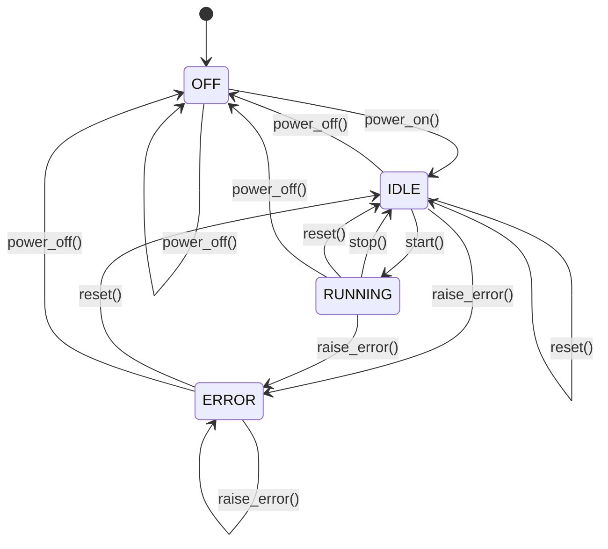

# 장비 시뮬레이터 클래스 구조

## 현재 구조: 데이터시트 기반 unit 및 제품 구성

이 절은 아래 2026-10-17 컨베이어 독립 장비 설계를 대체한다.
컨베이어 전용 클래스와 `conveyor.py`를 제거했다. 컨베이어는
`machine.py`의 **unit 객체**이며 `kind="conveyor"`로 구분한다.
`LineUnit`은 `unit`의 호환 별칭이고 별도 클래스가 아니다.

```text
BatteryLine(machine)
 ├─ frames: list[BatteryFrame]
 ├─ units: list[unit] ← 컨베이어와 일반 공정 유닛
 ├─ conveyors: units에서 kind="conveyor"인 객체를 참조하는 목록
 ├─ conveyor: 컨베이어 unit 참조 (현재 정확히 1개)
 ├─ inputs: list[product_input]
 └─ products: list[Product] (cells는 호환 별칭)
```

### unit 추가 멤버

| 멤버 | 타입 | 의미 |
| --- | --- | --- |
| `kind` | str | conveyor 또는 process |
| `length`, `width`, `height` | float | 구성 요소 전체 치수(mm) |
| `cvBelt` | tuple[float, float, float] 또는 None | 벨트 한 줄의 X 길이, Y 폭, Z 두께(mm) |
| `cvbeltAmt` | int | 벨트 개수. 일반 유닛 기본값은 0 |

기존 `name`, `coordinate`, `motors`, `cylinders`와 부품 생성 메서드는 유지한다.
기존 벨트는 `cvBelt=(11750, 30, 16)`, `cvbeltAmt=2`로 CSV에 옮겼다.
한 줄이면 Y 중앙에, 두 줄 이상이면 전체 `width` 안에 균등 배치한다.
벨트 폭의 합은 전체 폭을 초과할 수 없다. 벨트 시작·끝은 `cvBelt[0]`,
벨트 상면은 `cvBelt[2]`로 계산하므로 렌더링과 이송 경계가 일치한다.
하부 지지대의 단면 8×30 mm와 위치 오프셋은 화면 장식 상수로 유지한다.

### 기존 데이터시트 확장

`datasheets/battery_line.csv`를 Excel에서 열고 **CSV UTF-8**로 저장한다.
직접 `.xlsx` 파일을 읽는 기능은 없으며 CSV를 공통 입력으로 사용한다.
기존 8개 열 뒤에 다음 7개 열을 추가했다.

`cvBeltLength,cvBeltWidth,cvBeltHeight,cvbeltAmt,product,cycle,amount`

| type | 좌표 x/y/z | length/width/height | 추가 필드 |
| --- | --- | --- | --- |
| frame | 프레임 바닥 기준 중심 | 프레임 치수 | 추가 필드 공란 |
| conveyor | 벨트 형상 중심 | 유닛 전체 치수 | cvBelt 3개 치수와 cvbeltAmt 필수 |
| process | 형상 중심 | 유닛 치수 | 추가 필드 공란 |
| product | 제품 원형 좌표 | 제품 실제 X/Y/Z 크기 | product에 Cell 또는 Product |
| product_input | 투입 위치 input_pos | 공란 | product에 제품 행의 name, cycle(초), amount(정수) |

`product` 열은 제품 행에서는 클래스 구분, 투입기 행에서는 제품 이름 참조다.
제품과 투입기는 여러 행을 추가할 수 있으며 참조하는 행의 순서는 자유롭다.
이름은 파일 전체에서 고유해야 한다. 치수·주기는 유한한 양수, 개수는 양의 정수다.
필수값 누락이나 잘못된 참조는 CSV 행 번호와 함께 오류로 표시한다.
프레임 1개 이상, 컨베이어 정확히 1개, 투입기 1개 이상을 요구한다.
기존 8열 CSV는 새 형식으로 확장해야 한다.

### 제품과 투입 위치

`Product.size`와 `Cell.size`의 하드코딩 기본값을 없앴다. 직접 생성할 때에도
`Cell(size=(123, 600, 17.8))`처럼 크기를 전달해야 한다.
현재 CSV의 Battery Cell 행이 크기 `(123, 600, 17.8)`을 제공하고,
Cell Input 행이 `input_pos=(-5875, 0, 1288.9)`, `cycle=5`, `amount=7`을 제공한다.
제품 원형을 복제한 후 실제 생성 좌표는 투입 위치로 설정한다. 같은 배치의 나머지
제품은 X축 음의 방향으로 피치 간격을 둔다. 제품 크기에 맞춰 최소 피치도 계산한다.
CSV의 투입 좌표는 절대 좌표이므로 벨트 높이를 바꾸면 투입 Z도 직접 조정해야 한다.
Cell의 리드 장식 크기는 기존 화면 상수이며 제품 본체 크기와 구분한다.

`load_datasheet()`는 `(frames, units, inputs)`를 반환한다. `BatteryLine`이
기본 투입 위치나 Cell 크기를 계산해 넣던 코드는 제거했다. 화면은 실제 로드된
벨트 수·크기 및 제품 크기·좌표를 사용한다. UI 주기·개수 변경은 메모리에만 적용되며
영구 설정은 CSV를 수정한 후 재실행한다. 배포 EXE는 재빌드해야 반영된다.

변경 기록: 컨베이어를 독립 machine에서 데이터 기반 unit으로 전환하고,
기존 CSV에 벨트 속성, 제품 정의, 투입기 설정을 통합했다.

## 목적과 범위

생산 시설의 다양한 장비에 공통으로 필요한 상태와 제어 기능을 정의한다.
공통 제어는 `equipment.py`, 생산 장비 구성은 `machine.py`에 구현한다.
Python 3.10 이상을 사용한다. 요청한 일곱 클래스 이름은 소문자로 정의한다.
장비별 공정이나 물리적 동작은 향후 `machine`을 상속해 구현할 수 있다.

## 클래스 관계

```text
EquipmentState (str, Enum)
    OFF / IDLE / RUNNING / ERROR

Equipment
    ├─ 장비 이름과 상태 관리
    ├─ 전원 및 운전 제어
    ├─ 오류 처리와 초기화
    ├─ 가상 시간 진행
    └─ on_step(seconds): 장비별 동작 확장 지점
         ↑ 상속
    machine
        ├─ frames: list[frame]
        │    └─ coordinate: coordinate(x, y, z)
        └─ units: list[unit]
             ├─ coordinate: coordinate(x, y, z)
             ├─ motors: list[motor]
             └─ cylinders: list[cylinder]

part.create_motor() → motor 객체 생성
part.create_cylinder() → cylinder 객체 생성
```

`machine`과 `frame`/`unit`의 관계는 포함 관계다. 프레임과 유닛은 장비를
상속하지 않으며 장비 내부 구성 요소다. `machine`은 기존 `Equipment`를 상속한다.

## 생산 장비 구성 클래스

| 클래스 | 멤버 | 역할 |
| --- | --- | --- |
| `coordinate` | `x`, `y`, `z`: `float`, 기본값 각각 `0.0` | 3차원 좌표 |
| `frame` | `name`: `str`, `coordinate`: `coordinate` | 프레임 이름과 개별 좌표 |
| `machine` | `frames`: `list[frame]`, `units`: `list[unit]` | 프레임과 공정 유닛을 포함하는 장비 |
| `unit` | `name`, `coordinate`, `motors`: `list[motor]`, `cylinders`: `list[cylinder]` | 개별 공정의 좌표와 구동 부품 관리 |
| `part` | 인스턴스 멤버 없음 | 모터와 실린더 생성 팩토리 |
| `motor` | `name`, `position`, `speed`, `acc`, `dec`, `time` | 모터 이름과 구동 설정 |
| `cylinder` | `name`, `speed` | 실린더 이름과 속도 설정 |

`motor`의 `position`, `speed`, `acc`, `dec`, `time`은 각각 별개의
`list[float]`다. 같은 인덱스의 값이 하나의 구동 설정을 나타낸다.
`cylinder.speed`도 `list[float]`다. 모든 리스트는 기본적으로 비어 있으며,
기본 좌표와 리스트는 객체마다 독립적으로 생성된다.

좌표 단위와 기준점, 속도·가감속·시간 값의 단위는 아직 정하지 않았다.
프레임과 유닛 좌표 간 자동 변환이나 모터 이동에 따른 좌표 갱신은 구현하지 않았다.

### 생성 및 구성 메서드

| 메서드 | 동작 |
| --- | --- |
| `machine(name)` | 장비 이름과 빈 프레임·유닛 목록 생성 |
| `machine.add_frame(component)` | 프레임 객체 등록 |
| `machine.add_unit(component)` | 유닛 객체 등록 |
| `part.create_motor(name)` | 새로운 `motor` 반환, 정적 메서드 |
| `part.create_cylinder(name)` | 새로운 `cylinder` 반환, 정적 메서드 |
| `unit.add_motor(name)` | `part`를 통해 모터 생성 후 목록에 등록하고 반환 |
| `unit.add_cylinder(name)` | `part`를 통해 실린더 생성 후 목록에 등록하고 반환 |
| `motor.add_motion(position, speed, acc, dec, time)` | 다섯 설정 리스트에 구동 설정 한 행 추가 |

리스트에 직접 값을 넣을 수도 있다. 모터 리스트를 직접 수정하는 경우
같은 인덱스끼리 대응하도록 길이를 유지할 책임은 호출자에게 있다.
실린더 속도는 `speed.append()` 또는 `speed.extend()`로 추가한다.
현재 설정값의 범위 검증, 구동 시간 해석, 이동 계산은 포함하지 않는다.

### 사용 예제

```python
from machine import coordinate, frame, machine, unit

equipment = machine("생산 장비 1")
equipment.add_frame(frame("메인 프레임", coordinate(0, 0, 0)))

process = unit("이송 유닛", coordinate(100, 0, 50))
equipment.add_unit(process)
axis = process.add_motor("X축 모터")
axis.add_motion(position=100, speed=50, acc=10, dec=10, time=2)
clamp = process.add_cylinder("클램프 실린더")
clamp.speed.extend([20, 30])
```

`machine`은 전원, 운전, 오류, 가상 시간 기능을 `Equipment`에서 상속한다.
현재 `step()`은 장비의 운전 누적 시간만 진행한다. 유닛과 부품을 자동으로
구동하지 않으며 `get_status()`도 기존 공통 상태만 반환한다.

## EquipmentState

| 항목 | 값 | 의미 |
| --- | --- | --- |
| `OFF` | `"off"` | 전원 꺼짐 |
| `IDLE` | `"idle"` | 전원 켜짐, 운전 대기 |
| `RUNNING` | `"running"` | 운전 중 |
| `ERROR` | `"error"` | 오류로 운전 중단 |

## Equipment 속성

| 속성 | 타입 | 초기값 | 역할 |
| --- | --- | --- | --- |
| `name` | `str` | 생성자 인수 | 장비 이름 |
| `_state` | `EquipmentState` | `OFF` | 내부 장비 상태 |
| `_error_message` | `str \| None` | `None` | 현재 오류 메시지 |
| `_elapsed_seconds` | `float` | `0.0` | 운전 누적 가상 시간(초) |
| `state` | `EquipmentState` | 내부 상태 | 읽기 전용 프로퍼티 |

밑줄로 시작하는 속성은 내부 관리용이다. 외부에서는 제어 메서드로 상태를
변경하고 `state` 또는 `get_status()`로 조회한다.

## Equipment 메서드

| 메서드 | 반환 타입 | 동작 및 조건 |
| --- | --- | --- |
| `__init__(name: str)` | `None` | 이름이 공백뿐이면 `ValueError` 발생 |
| `power_on()` | `None` | `OFF`에서 `IDLE`로 전환 |
| `power_off()` | `None` | 모든 상태에서 `OFF`로 전환하고 오류 해제. 누적 시간 유지 |
| `start()` | `None` | `IDLE`에서 `RUNNING`으로 전환 |
| `stop()` | `None` | `RUNNING`에서 `IDLE`로 전환 |
| `raise_error(message: str)` | `None` | 전원이 켜져 있으면 오류를 기록하고 `ERROR`로 전환 |
| `reset()` | `None` | 오류와 누적 시간 초기화. 전원이 켜져 있으면 `IDLE`, 꺼져 있으면 `OFF` 유지 |
| `step(seconds: float)` | `None` | 시간을 검증하고, 운전 중이면 `on_step()` 호출 후 누적 시간 증가 |
| `on_step(seconds: float)` | `None` | 기본 구현은 아무 동작도 하지 않음. 하위 클래스에서 구현 |
| `get_status()` | `dict[str, str \| float \| None]` | 장비 상태의 새 딕셔너리 반환 |
| `_require_state(expected: EquipmentState)` | `None` | 현재 상태가 기대 상태와 다르면 `RuntimeError` 발생 |

`power_on()`, `start()`, `stop()`은 허용되지 않는 상태에서 호출하면
`RuntimeError`가 발생한다. `raise_error()`는 `OFF`에서 `RuntimeError`,
전원이 켜진 상태에서 빈 오류 메시지를 전달하면 `ValueError`가 발생한다.

## 상태 전환



## 가상 시간 처리

1. 호출자가 `step(seconds)`에 진행할 시간을 전달한다.
2. 시간이 유한한 양수인지 확인한다. 0, 음수, NaN, 무한대는 `ValueError`를 발생시킨다.
3. `RUNNING`이면 `on_step(seconds)`로 장비별 동작을 실행한다.
4. `on_step()`이 정상 반환하면 운전 누적 시간을 증가시킨다.

운전 중이 아니면 유효한 시간 입력에 대해 동작과 누적 시간 모두 진행하지 않는다.
실제 대기는 발생하지 않는다. `on_step()`에서 예외가 발생하면 누적 시간은 증가하지
않지만, 하위 클래스가 이미 변경한 값은 자동으로 되돌리지 않는다.

## 상태 조회 형식

```python
{
    "name": "장비 1",
    "state": "running",
    "elapsed_seconds": 1.0,
    "error_message": None,
}
```

`state` 값은 열거형의 문자열 값이며, 누적 시간의 단위는 초다.

## 장비별 확장 규칙

- 생성자에서 `super().__init__(name)`을 호출하고 장비별 설정과 측정값을 추가한다.
- `on_step(seconds)`에서 생산량, 온도, 이동 거리 등의 변화를 구현한다. 실제 대기를 넣지 않는다.
- 장비별 상태를 공개하려면 `get_status()`에서 부모의 결과에 항목을 추가한다.
- 추가 자원의 초기화나 정지가 필요하면 관련 메서드를 재정의하고 부모 동작을 함께 수행한다.
- 부모의 `reset()`은 공통 오류와 누적 시간만 초기화한다. 장비별 값의 초기화 정책은 하위 클래스에서 정한다.

현재 `Equipment`는 직접 생성할 수 있는 일반 클래스다. `on_step()` 구현을
강제하는 추상 클래스는 아니다.

## 향후 구조 확장

아래 구성 요소는 설계 방향이며 현재 구현에는 포함되지 않는다.

| 구성 요소 | 책임 |
| --- | --- |
| 장비별 하위 클래스 | 현재 구성 모델을 바탕으로 개별 공정 실행과 측정값 계산 |
| 시설 시뮬레이터 | 여러 장비 등록, 공통 가상 시간 진행, 실행 순서 관리 |
| 자재 흐름 모델 | 장비 간 투입과 배출, 버퍼, 처리 조건 |
| 통신 어댑터 | 외부 명령을 장비 메서드 호출로 변환하고 상태 전달 |
| 화면 및 로그 | 상태 표시와 동작 이력 기록 |

시설 전체 시간과 개별 장비의 운전 누적 시간은 별도로 관리한다.
장비 기본 클래스에는 화면, 통신 프로토콜, 시설 전체 실행 관리를 넣지 않는다.

## 변경 기록

- 2026-10-10: `coordinate`, `frame`, `machine`, `unit`, `part`, `motor`, `cylinder` 추가.
- `machine`에 프레임·유닛 포함 관계, `frame`과 `unit`에 개별 좌표 추가.
- `unit`의 모터·실린더 생성은 `part` 팩토리를 사용하도록 구성.
- 모터의 다섯 설정 리스트와 실린더 속도 리스트 추가, `main.py` 예제 갱신.
# 배터리 라인 데이터시트 확장

`BatteryLine(machine)`은 `datasheets/battery_line.csv`에서 프레임과 유닛을 읽습니다.
`line_datasheet.py`의 `BatteryFrame(frame)`은 `length`, `width`, `height`와
X축 시작/끝 속성을 추가하고, `LineUnit(unit)`은 `kind` 및 치수를 추가합니다.
`BatteryLine.frames`, `BatteryLine.units`, `BatteryLine.conveyors`가 실제 구성 객체 목록입니다.
기존 `FRAME_SIZES` 상수는 제거되었습니다. 3D 화면은 이 객체 목록을 렌더링합니다.
CSV 열과 좌표 규칙, 실행 예제는 README의 데이터시트 항목을 참고하세요.

## 이전 설계 기록 — 2026-10-17: 컨베이어 장비 및 제품 투입 기능

아래는 변경 전 기록이다. 현재 클래스와 CSV 계약은 문서 맨 위의 현재 구조를 따른다.

```text
Equipment → machine → BatteryLine
                    → conveyor
unit → LineUnit (일반 공정 유닛)
Product → Cell

BatteryLine
 ├─ frames: list[BatteryFrame]
 ├─ units: list[LineUnit]
 ├─ conveyors: list[conveyor]
 ├─ conveyor: conveyors[0] 참조
 ├─ inputs: list[product_input]
 └─ products: list[Product] (cells는 기존 API 호환 별칭)
```

### conveyor

`conveyor.py`의 `conveyor(machine)`은 독립 장비 클래스다. 기존의
`LineUnit(kind="conveyor")` 구성을 대체한다. CSV 열 형식은 유지하며,
`type=conveyor` 행에서 이름, 중심 좌표, 길이, 폭, 높이를 읽어 생성한다.
`load_datasheet()` 반환값은 `(frames, units, conveyors)`로 변경했다.
현재 라인은 컨베이어 1개만 허용한다.

| 멤버/속성 | 의미 |
| --- | --- |
| `coordinate` | 형상 중심의 x, y, z 절대 좌표(mm) |
| `length`, `width`, `height` | X 길이, 두 벨트의 전체 Y 폭, 벨트 Z 두께(mm) |
| `kind` | `"conveyor"` |
| `x_start`, `x_end`, `belt_top` | 치수와 좌표에서 계산한 시작점, 끝점, 상면 |
| `frames`, `units` | machine에서 상속한 내부 구성 목록, 초기에는 비어 있음 |

공통 전원과 운전 메서드를 상속한다. 현재 라인의 이송 및 투입 제어는
`BatteryLine`이 수행하며, 컨베이어 자체 운전 상태는 라인과 자동 연동하지 않는다.

### product_input

`product_input.py`에 제품 모델과 생성 기능을 정의한다.

| 멤버 | 타입 | 의미 |
| --- | --- | --- |
| `input_pos` | `coordinate` | 배치 선두 제품 중심의 절대 x, y, z 좌표(mm) |
| `product` | `Product` 또는 하위 클래스 객체 | 생성 시 독립 복제할 제품 원형. x, y, z 보유 |
| `cycle` | `float` | 제품 생성 주기(시뮬레이션 초), 유한한 양수 |
| `amount` | `int` | 한 주기에 생성할 개수, 1 이상의 정수 |

`Product`는 `id`, `x`, `y`, `z`, `size=(X길이,Y폭,Z높이)`를 갖는다.
`Cell(Product)`의 기본 크기는 `(123, 600, 17.8)`이다. 다른 제품은
`Product`를 사용하거나 상속해 추가한다. 생성 시 원형의 좌표는 투입 좌표로
설정되고, 배치 나머지 제품은 X축 음의 방향으로 `line.pitch` 간격을 둔다.
Y/Z 좌표는 `input_pos`를 그대로 사용한다. 생성 제품의 ID는 라인에서 부여한다.

| 메서드 | 동작 |
| --- | --- |
| `configure(cycle=..., amount=...)` | 설정 검증 후 반영하고 해당 투입기의 타이머 초기화 |
| `events(seconds)` | 구간 내 모든 생성 시각 반환, 여러 주기를 한 번에 처리 |
| `create_batch(pitch)` | 설정한 제품 원형을 amount개 복제해 반환 |
| `reset()` | 주기 타이머 초기화 |

`BatteryLine.start_input()`으로 주기 투입을 시작한다. 첫 생성은 한 주기 후다.
기본 설정은 Cell, 5초, 7개이며 UI에서 주기와 개수를 변경할 수 있다.
STOP은 이송과 주기를 함께 일시정지한다. START 재클릭은 중복 생성하지 않으며
재개 시 남은 주기를 이어간다. 제품 초기화는 제품 목록과 주기 타이머를 지운다.
전원 끄기 및 reset은 주기 투입을 해제하고 타이머를 초기화한다.
기존 `inject_batch()`는 설정된 제품을 즉시 한 배치씩 생성하는 수동 API다.

제품별로 서로 다른 투입기를 `BatteryLine(inputs=[...])`에 전달할 수 있다.
3D 화면은 각 제품의 실제 x/y/z와 크기를 사용하며 Cell에는 리드를 표시한다.
UI는 기본 투입기 하나의 주기/개수를 편집한다. 여러 제품의 설정과 투입 좌표는
Python API로 지정한다. 제품 투입 설정을 위한 별도 데이터시트는 아직 없다.

```python
from battery_line import BatteryLine
from machine import coordinate
from product_input import product_input, Cell, Product

line = BatteryLine(inputs=[
    product_input(coordinate(-5875, 0, 1288.9), Cell(), cycle=5, amount=7),
    product_input(coordinate(-5875, 500, 1330),
                  Product(size=(100, 100, 100)), cycle=8, amount=2),
])
line.start_input()
line.step(8)  # 5초에 Cell 7개, 8초에 일반 제품 2개 생성
```

투입 위치와 주기는 설정값을 그대로 따른다. 제품 간 충돌 검사나 투입 대기는
아직 없으므로 속도·주기·개수에 따라 제품이 겹칠 수 있다. 제품 종류별 이송 속도는
현재 공통 `line.speed`를 사용한다. 배포 EXE에는 소스 변경 후 재빌드가 필요하다.
